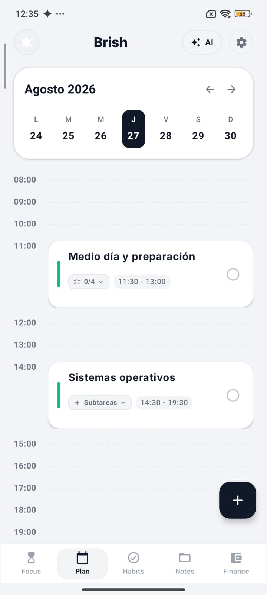
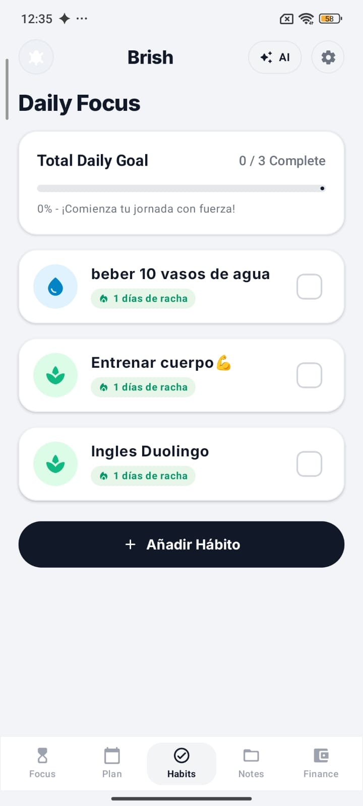
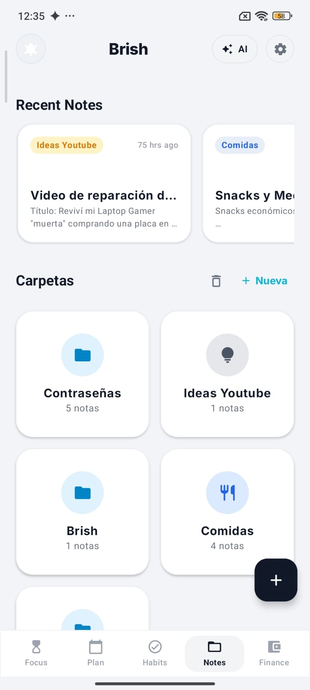

# Brish

**Tu horario, tus entregas y tus apuntes, organizados.**

Aplicación Android nativa para organizar el día y los estudios: Hoy, Agenda, Cursos y Notas.

[RETH](https://rethagency.web.app/) · [Código fuente](https://github.com/dzenwertz/Brish-App)

## Descargar

[**Descargar Brish v1.2.22 para Android**](https://github.com/dzenwertz/Brish-App/releases/download/v1.2.22/Brish-v1.2.22.apk)

APK anterior para Android 7.0 o posterior. La nueva estructura descrita aquí corresponde al código actual; ese APK conserva la experiencia anterior.

La versión de desarrollo actual es **1.3.0**. Su validación y los escenarios pendientes en dispositivo están en [validación de Brish](design/validation.md).

## Qué problema resuelve

Brish separa el horario personal de las entregas académicas y permite conservar los apuntes de cada curso. Hoy resume actividades y entregas en bloques distintos y ofrece un temporizador de enfoque.

## Funciones principales

- Hoy: actividades del día, entregas pendientes y Pomodoro.
- Agenda: horario con actividades, repetición y subtareas. Las entregas de Cursos no se añaden automáticamente.
- Cursos: espacios de aprendizaje, entregas con o sin vencimiento y apuntes vinculados.
- Notas: biblioteca, búsqueda, carpetas, filtro por curso y editor con autoguardado local y recuperación de borradores.
- Papelera persistente para recuperar apuntes eliminados desde Cursos o Notas.
- Ajustes: apariencia, Pomodoro y exportación JSON de los registros anteriores de Finanzas y Hábitos.

## Capturas de la versión anterior

  
  
  

## Alcance de esta versión

Finanzas y Hábitos se retiraron del producto; sus registros se conservan para exportación. La IA está pospuesta. Se retiraron mascotas, monedas, XP, rachas, insignias y recompensas. Los apuntes y tarjetas existentes se conservan, junto con los derechos de suscripción.

El guardado local y la sincronización son estados distintos. Los pendientes se conservan por cuenta al cerrar sesión; no se muestran a otra cuenta.

## Ejecutar el proyecto

1. Abre la carpeta `Android` en Android Studio.
2. Añade tu propio `Android/app/google-services.json` para las funciones de Firebase.
3. Define `sdk.dir` en `Android/local.properties` si Android Studio no lo hace automáticamente.
4. Sincroniza Gradle y ejecuta la variante `debug`.

Requisitos: Android Studio, JDK 17 y Android SDK 35.

## Autoría

Diseñado y desarrollado por **Joseph Ivan Cachay Vargas**, fundador de **RETH**.

Copyright © 2026 Joseph Ivan Cachay Vargas / RETH. Todos los derechos reservados. Consulta [NOTICE](NOTICE.md).
