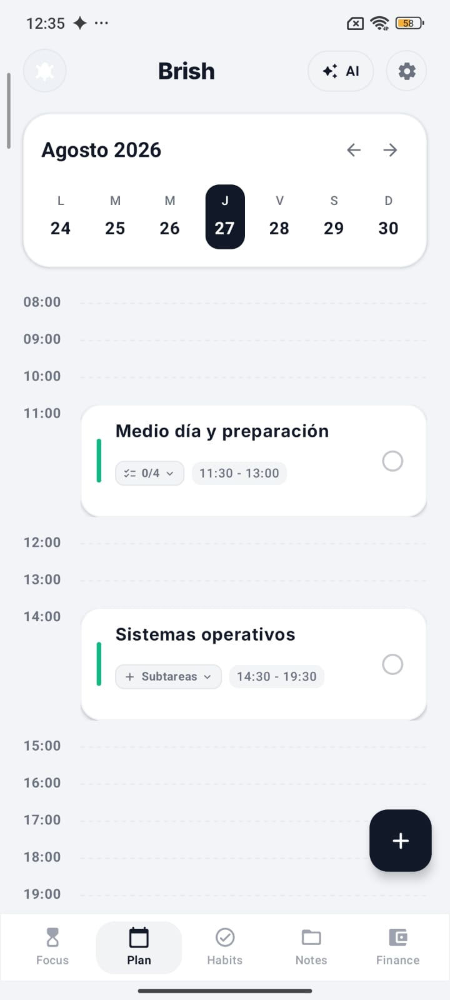
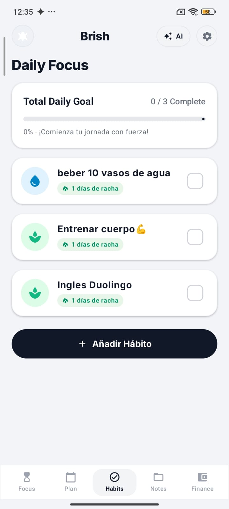
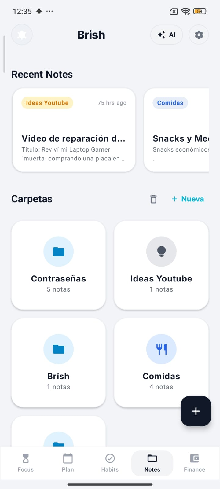

# Brish

**Tu día, organizado en un solo lugar.**

Agenda, Pomodoro, hábitos, notas y finanzas personales en una aplicación Android nativa.

[RETH](https://rethagency.web.app/) · [Código fuente](https://github.com/dzenwertz/Brish-App)

## Qué problema resuelve

Brish evita repartir la organización diaria entre varias aplicaciones. Une planificación, enfoque y seguimiento personal en una interfaz limpia y configurable.

## Funciones principales

- Agenda diaria con tareas, horarios y subtareas.
- Temporizador Pomodoro con sesiones enlazadas a tareas.
- Hábitos con rachas y progreso diario.
- Notas organizadas por carpetas.
- Registro sencillo de finanzas personales.
- Brish IA para ordenar ideas y proponer acciones revisables.

## Vistas

  
  
  

## Brish IA y privacidad

Cada persona conecta su propia clave de [OpenCode Zen](https://opencode.ai/docs/zen/). La clave se cifra con Android Keystore y permanece en el dispositivo. Los modelos gratuitos dependen de la disponibilidad y las condiciones vigentes de OpenCode.

La IA propone cambios; el usuario los revisa y confirma antes de aplicarlos.

## Ejecutar el proyecto

1. Abre la carpeta `Android` en Android Studio.
2. Añade tu propio `Android/app/google-services.json` para las funciones de Firebase.
3. Define `sdk.dir` en `Android/local.properties` si Android Studio no lo hace automáticamente.
4. Sincroniza Gradle y ejecuta la variante `debug`.

Requisitos: Android Studio, JDK 17 y Android SDK 35.

## Autoría

Diseñado y desarrollado por **Joseph Ivan Cachay Vargas**, fundador de **RETH**.

Copyright © 2026 Joseph Ivan Cachay Vargas / RETH. Todos los derechos reservados. Consulta [NOTICE](NOTICE.md).
